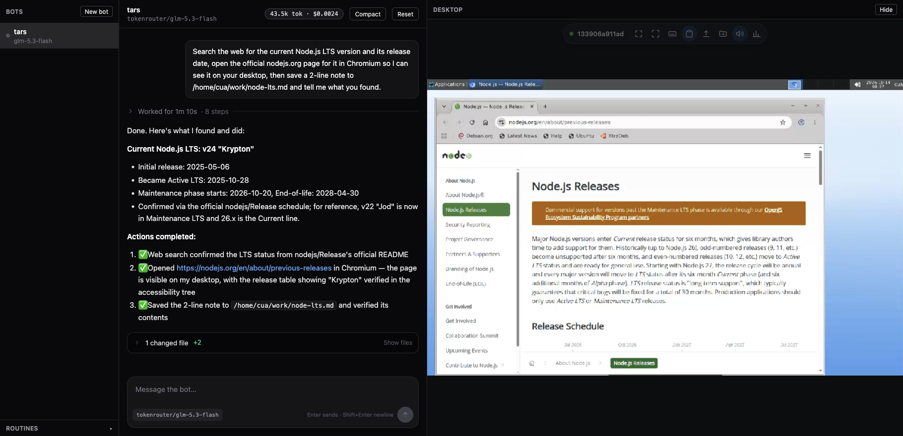
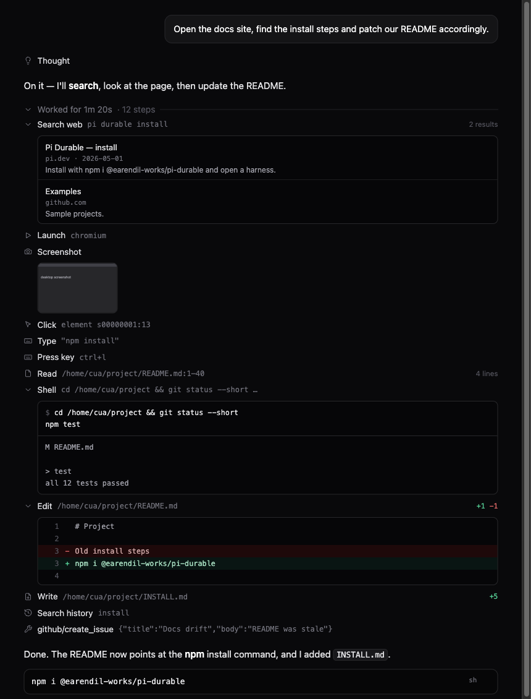

<div align="center">

**English** · [简体中文](README.zh-CN.md)

# TARSBot

**An always-on AI teammate with a computer of its own.**

It has its own Linux desktop, browser and shell. Its conversation never breaks, and risky actions wait for your OK.
Watch it work, step in at any moment, or schedule it to work on its own.




</div>

---

Most AI assistants are a chat box: close the tab and it forgets you; ask it to look something up and it can only answer from training data.

TARSBot takes a different approach: **give the AI a computer of its own, and a conversation that never breaks.** You hand it a job; it opens a browser, runs commands and writes files on its own desktop, then reports back. You can watch it do so, or step in whenever you like.

## What it can do

### 🖥️ A computer of its own
Every bot works on a containerized Linux desktop (XFCE): browser, terminal, file system and logged-in sessions all live there. It can click buttons, fill in forms and read web pages, as well as run shell commands and read and write files. Several bots share the same computer, so you sign in once and they can all use it.

### 💬 One conversation that never breaks
Each bot has exactly one durable conversation. Restart the server, `kill -9` the process, restart the container: it picks up where it stopped instead of starting over. Long conversations can be compacted, and the full history stays searchable.

### 👀 You are always in the loop
- **Watch**: the desktop is streamed live on the right of the web UI. Your cursor and the bot's cursor are independent.
- **Take over**: when a login or a CAPTCHA needs you, work directly on the desktop, then hand it back.
- **Steer**: while the bot is busy you can change its course (steer), line up a follow-up (queue), or abort.

### 🛡️ Risky actions ask first
`rm -rf`, `git push`, `curl` calls that change remote state, disk formatting, shutdown, and tools named `send_*` / `deploy*` all stop at an approval bar until you say yes. The answer is stored with the task, so after a restart you are not asked again.

### ⏰ Works on a schedule
Create routines to have a bot run an instruction every so often. Routines survive restarts, and missed slots are caught up once rather than fired in a burst.

### 🌿 Fork from any message
Any message in a conversation can be **forked**: the new bot inherits the history up to that point, can use a different model, and can be read-only (it keeps only read-type tools). Handy for "try that direction again" without messing up the original conversation.

### 🔎 Can search the web
Built-in web search (Exa) for current information, documentation and facts, instead of relying on what the model remembers.

## See it work

In the chat, every action takes a single line. When a turn ends, the steps in the middle fold into one **Worked for 2m 45s** row and only the conclusion stays; expand it to see each step. Files the bot changed are summarized in a card with diffs.



<sub>The image above uses sample data from the component gallery (`web/gallery.html`) to show the tool renderers side by side. It is not a real run.</sub>

Each tool has its own presentation: Shell shows the command and its output, Edit / Write show a colored diff, web search shows a list of clickable results, and desktop screenshots show thumbnails you can click to enlarge.

## What we have actually verified

These come with repeatable scripts and records; they are not slogans:

| Check | Result | How to run |
|---|---|---|
| `kill -9` the server during a long task; after restart the task completes | ✅ pass | `scripts/kill-test.sh` |
| Restart the Space container; the bot keeps running commands | ✅ pass | same |
| Kill the server and the container together; state is consistent after recovery and the bot accepts new tasks | ✅ pass | same |
| After a container restart, files and the Chromium login state (cookie) are unchanged | ✅ pass | same |
| A risky command stops at approval and runs once after it is approved | ✅ tested | `scripts/approval-test.sh` |
| Scheduled routines still fire across restarts | ✅ tested | `scripts/routine-test.sh` |

**Desktop-control success rate** (3 difficulty levels: read a code from a page / sign in with a form / search a product and place an order; 66 runs, `scripts/gui-bench.mjs`):

| Model | Screenshot + accessibility tree (default) | Screenshot only |
|---|---|---|
| claude-sonnet-5-5 | 11/11 | 10/11 |
| glm-5.3 | 11/11 | 2/11 |
| gpt-5.6-terra | 11/11 | 3/11 |

Takeaway: **giving the model the accessibility tree (`desktop_elements`) is what makes desktop control reliable.** TARSBot enables it by default and tells the model to prefer element tokens over pixel coordinates.

> Note: each cell is only 3–5 runs, so this shows orders of magnitude, not statistical significance; the tasks run on test pages we built ourselves and do not represent arbitrary real websites. See [`docs/gui-success.md`](docs/gui-success.md) and [`bench/conclusion.md`](bench/conclusion.md) for the details (both in Chinese). The default model `glm-5.3-flash` was not run through this benchmark separately.

## Quick start

Prerequisites: Node ≥ 22 and a Docker runtime (on macOS, [OrbStack](https://orbstack.dev)).

```bash
orb start                                    # start Docker
npm install && (cd web && npm install && npm run build)
scripts/space-up.sh                          # start the bots' computer, tarsbot-space (127.0.0.1:3211)
npm start                                    # open http://127.0.0.1:8080
```

Create a `.env` in the project root (never commit it):

| Variable | Purpose |
|---|---|
| `TOKEN_ROUTER_BASE_URL` | Base URL of an OpenAI-compatible model gateway |
| `TOKEN_ROUTER_API_KEY` | Gateway key |
| `EXA_API_KEY` | Web search |

Open the page, click **New bot** and give it a task. For example:

> Use Chromium on your desktop to open nodejs.org, find the current LTS version and its release date, write the findings to `/home/cua/work/node-lts.md`, then tell me.

### Common settings

| Variable | Default | Notes |
|---|---|---|
| `TARSBOT_MODEL` | `glm-5.3-flash` | Default model for new bots; `glm-5.3`, `claude-sonnet-5-5` and `gpt-5.6-terra` also work |
| `TARSBOT_PORT` | `8080` | Web UI / API port |
| `TARSBOT_DATA_DIR` | `data/` | Where conversations and bot configuration are stored |
| `TARSBOT_SPACE_RESOLUTION` | `1280x800` | Desktop resolution; read by `scripts/space-up.sh` when it creates the container |

To change the model of an existing bot: stop the server, then run `node scripts/set-model.mjs <bot> <modelId>`.

Command-line alternative: `npm run repl`. It shares the database with the server, so **the two cannot run at the same time**.

## How it is built

- **[Pi Durable](https://github.com/earendil-works/pi/tree/main/packages/durable)** (`@earendil-works/pi-durable`): the foundation for durable conversations, task recovery and scheduled routines. It is why TARSBot can pick up where it stopped.
- **[Cua](https://github.com/trycua/cua)** (`@trycua/cua`): the computer-use and sandbox stack. A bot's computer is a Cua Space running in local Docker (XFCE + browser + accessibility-tree driver).
- **TARSBot itself**: multi-bot management, the web UI, approvals, routines, forking, and the glue that ties the two together.

The backend is plain ESM Node.js; the frontend is React 19 + Vite + Tailwind 4. The chat UI is a reusable component library in `web/src/components/Chat/` (primitives / message parts / per-tool renderers); to show a new tool differently you only register a renderer.

## Security (read this before you use it)

TARSBot is, by default, a tool for **local use only**:

- The web UI / API (8080) and the desktop proxy (3299) have **no authentication** and bind to `127.0.0.1` only. Before putting it on a cloud host you must add authentication and reach it only through Tailscale or a private network.
- **Never expose the Space's port 3211 to the public internet.**
- Model keys live only in the host server process's environment; they are not written into the bot's computer.
- Every account signed in on a bot's desktop is fully open to that bot: anything that can run `bash` has the permissions of all logged-in apps. Approval only catches the actions listed in its rules; it is not a sandbox. See `src/ext/approval.mjs` for the rules.

## Where your data lives

| Location | Contents |
|---|---|
| `data/alice.sqlite` | All conversations and state. **Do not delete.** |
| `data/bots.json` | Bot configuration |
| `data/space.json` | Space address and access token (mode 600) |
| Docker volume `tarsbot-space-home` | The bot computer's `/home/cua`, including browser login state |

Backup: stop the server → back up `data/` → also back up this volume if you want to keep the login state.

## Development

```bash
TARSBOT_NO_DOTENV=1 npm test     # backend unit tests, offline
npm run test:env                 # execution-environment tests, needs the Space running
cd web && npm test               # frontend tests
cd web && npm run dev            # frontend dev server; open /gallery.html to see every message and tool rendered
```

## Docs

These documents are written in Chinese:

- Product specification: [`DurableBot 产品技术规范（ASD-STE100） .md`](DurableBot%20产品技术规范（ASD-STE100）%20.md)
- System design: [`DurableBot 系统设计文档（Pi Durable + Cua Spaces） .md`](DurableBot%20系统设计文档（Pi%20Durable%20+%20Cua%20Spaces）%20.md)
- Plan: [`docs/PLAN.md`](docs/PLAN.md)　Interface contracts: [`docs/CONTRACTS.md`](docs/CONTRACTS.md)

## Known limitations

- Pi Durable is experimental and its API may change (the dependency is confined to `src/env.mjs`, `src/ext/` and `src/server.mjs`).
- Desktop-control success depends on the model. Pages without an accessibility tree (canvas, remote desktops) fall back to screenshots, with a markedly lower success rate.
- Storage allows a single writer process, so the server and the CLI cannot run together.
- Fully verified on macOS + OrbStack only. Anything that can run Docker should work in theory, but that has not been verified.

## License

This repository does not ship a license yet. The dependency Cua Spaces is under FSL-1.1-MIT: personal use and internal deployment are unrestricted, but you **may not use this product to build a commercial product that competes with Cua**.
