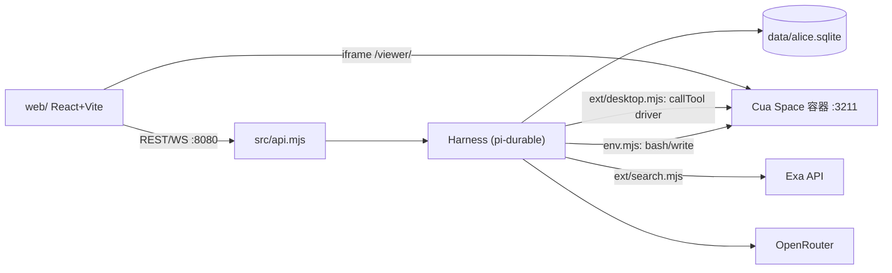
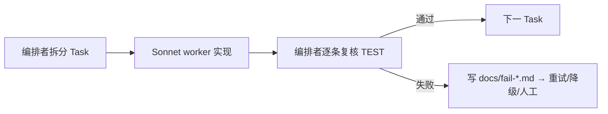

# TARSBot Demo 实施计划

**目标**：在本机（macOS + OrbStack）跑通 TARSBot 完整 demo，分阶段实现并逐阶段验收。
**依据**：《TARSBot 产品技术规范》（REQ/TEST 编号）与《TARSBot 系统设计文档》（WP 编号）。
**执行方式**：kiro-cli 编排，Sonnet 作为主力 worker；编排者逐阶段复核验收。

## 1. 问题陈述

验证"pi-durable 做主脑 + Cua Space 做电脑"的常驻 AI 队友是否可行，交付一个可演示的产品：
- 聊天派活
- 实时看桌面、随时接管
- 崩溃后能恢复
- 多 Bot、定时例程、审批

## 2. 需求与决策

| 项 | 决策 |
|---|---|
| 主脑协议 | 使用 pi-durable 自有协议（`watchEvents` / `viewState`），不做 ACP |
| 前端 | React + Vite + Tailwind v4；严格分层（见 §5.3），后续可平滑替换为 ai-elements |
| 网络搜索 | 自建 `web_search` 工具，使用 Exa（`EXA_API_KEY`），`replay:"safe"` |
| 模型接入 | OpenRouter（`openrouterProvider`） |
| 版本锁定 | pi-durable / pi-ai / chord `1.4.0`，`@trycua/cua` `0.4.1`（精确版本） |
| 范围外 | 多租户、ACP、Teleport、云迁移（WP10） |

## 3. 前置条件

- [ ] OrbStack 已启动
- [ ] 当前 shell 已设置 `OPENROUTER_API_KEY`
- [ ] 已设置 `EXA_API_KEY`（Task 7 需要）
- [ ] Node ≥ 22（已确认 v22.23.1）

## 4. 调研结论（对设计文档的修正）

已核对 npm 包与类型定义，尚未实际运行。

1. **Space 没有 `shell.run(argv)`**：只有 `space.bash(command: string, timeoutMs?: bigint)`，返回 `{stdout, stderr, exitCode?}`，非流式。
   - `env.exec(argv)` 需自行对 argv 做 shell 转义。
   - `onOutput` 在命令结束后一次性回调。
2. **没有现成的文件读取接口**：`openBinaryReader` / `openDirReader` 需用 `bash`（`base64`、`stat`、`ls`）或 `space.download` 实现；写文件可用 `space.write(path, ArrayBuffer)`。
3. **`SpaceCreateOptions` 不支持挂载 volume**：
   - 阶段 A/B 用 `embedded().spaces().create()` 快速起步。
   - 阶段 C 改为 `docker run -v space-data:/home/user ... ghcr.io/trycua/linux:24.04` + `spaces.add(url, token)`，以满足 F04。
4. **`space.callTool(tool, argsJson字符串, "driver", timeoutMs)`**：参数是 JSON 字符串。真实工具名以 `space.listTools("driver")` 为准。
5. **pi 没有可直接复用的 Web 前端**：pi-web-ui 绑定 pi-agent-core 0.7x，与 durable 1.0.4 不兼容。渲染数据来源为 `watchEvents`（快照 + 增量），参考 `test/examples/19-json.ts`、`21-late-join.ts`。
6. **pi 不自带网络搜索**：自建 Exa 工具。
7. **定时例程**：用 pi-durable 后台 task 实现以保证跨重启存活；`@trycua/cua/spaces/routines` 仅作参考。

## 5. 方案设计

### 5.1 架构



### 5.2 后端目录

```
src/
  config.mjs       # 默认模型、端口、路径
  server.mjs       # 组合启动：harness + api + 托管 web/dist
  harness.mjs      # openHarness()：Harness.open + resume
  space.mjs        # getSpace()：create（A/B）或 add（C）
  env.mjs          # CuaEnv: ExecutionEnv 适配
  bots.mjs         # bots.json 注册表、createBot、forkBot
  api.mjs          # REST + WS
  repl.mjs         # 命令行对话（调试用）
  ext/
    desktop.mjs  search.mjs  approval.mjs  routines.mjs  preamble.mjs
scratch/           # 探针脚本
scripts/           # space-up.sh、kill-test.sh、gui-bench.mjs
test/              # node:test / vitest
docs/              # PLAN.md、driver-tools.txt、gui-success.md、recovery-test.md、fail-*.md
```

### 5.3 前端分层（模块化约束）

```
web/src/
  lib/api.ts        # REST
  lib/stream.ts     # WS + 自动重连
  lib/reducer.ts    # 纯函数：snapshot + events → ViewModel（唯一读取 pi 协议的文件）
  types.ts          # ViewModel：Message / TextPart / ThinkingPart / ToolPart / Usage
  hooks/useBotStream.ts
  components/
    BotList.tsx  DesktopPane.tsx  UsageBadge.tsx  ApprovalBar.tsx
    Chat/MessageList.tsx  MessageItem.tsx  ThinkingBlock.tsx  ToolCard.tsx  Composer.tsx
```

规则：
- 组件只消费 `ViewModel`，不直接读 pi 事件。
- `reducer.ts` 必须有 Vitest 单测。
- 开发时 Vite 代理 `/api` → `127.0.0.1:8080`；生产由 `server.mjs` 在 8080 托管 `web/dist`。
- 只用纯 Tailwind，不引入组件库。

### 5.4 执行与验收流程



## 6. 任务分解

### 阶段 A：打底（Task 1–5）

**Task 1：项目骨架**
- 目标：建立可构建的空项目。
- 实现：`package.json`（`"type":"module"`，`engines.node>=22`，精确版本依赖 pi-durable/pi-ai/chord 1.0.4、@trycua/cua 0.4.1）；`.gitignore`（`data/`、`node_modules`、`.env`、`web/dist`）；`docs/PLAN.md`；`npm test` 使用 `node --test`。
- 测试：`npm install` 成功；占位测试通过。
- Demo：`npm test` 全绿。

**Task 2：WP0 Space 探针**
- 目标：本机拉起 Space 并调通原语。
- 实现：`src/space.mjs` 的 `getSpace()` 单例走 `embedded().spaces().create(SpaceCreateOptions.create({...}))`；`scratch/space-probe.mjs` 依次执行 `bash("uname -a")`、`listTools("driver")` 写入 `docs/driver-tools.txt`、调用一次截图类 driver 工具并保存 PNG 到 `scratch/`。
- 测试：TEST-F02-0；`docker ps` 可见容器；`/viewer/` 可见桌面。
- Demo：浏览器看到容器桌面；终端打印 driver 工具清单。

**Task 3：WP1 模型冒烟**
- 目标：确认 OpenRouter 可用。
- 实现：`scratch/model-smoke.mjs`：`createModels()` + `openrouterProvider()`，`complete("ping")`；默认模型写在 `src/config.mjs`。
- 测试：TEST-F08-0（打印 usage 与 cost）。
- Demo：终端输出回答与花费。

**Task 4：WP2 Harness 骨架 + 命令行对话**
- 目标：持久化对话主循环跑通（暂不接 Space）。
- 实现：`src/harness.mjs` 封装 `Harness.open(openNodeSqliteStorage("data/alice.sqlite"), {models, registry, settings})` 与 `resume()`（settings 按设计文档 §6.6）；`src/bots.mjs`（`data/bots.json` 注册表，`createBot({name, model, instructions})` → `createConversation` + `configure`）；`src/repl.mjs`（选择 Bot → `submit` → 用 `watchEvents` 打印文本/思考/工具事件）；`ext/preamble.mjs`。
- 测试：MemoryStorage + faux provider 单测（创建 Bot，submit 后 wait 为 done）；TEST-F01-0（重启后历史仍在）。
- Demo：REPL 问"法国首都"得到回答；重启后可见历史。

**Task 5：WP3 ExecutionEnv 适配器**
- 目标：`read`/`write`/`edit`/`bash` 在容器内执行。
- 实现：`src/env.mjs` 的 `CuaEnv`：`id="cua:main"`；`exec`：argv → shell 转义 → `space.bash`；`openBinaryReader`：`stat` + `dd | base64`；`openDirReader`：`ls`/`find` 解析；写用 `space.write`。Harness 接入 `env: spaceEnv()`，registry 安装 `CodingTools`。降级：一致性套件两轮不过则先只开放 `bash` 并写 fail 文档。
- 测试：argv 转义单测（空格、引号、`$`、换行）；TEST-F03-0（`registerEnvConformance`，配合 vitest）；TEST-F03-1（`docker exec <容器> cat /home/user/work/hello.txt`）。
- Demo：REPL 让 Bot 建 hello.txt，宿主 `docker exec` 可见。

### 阶段 B：可演示（Task 6–10）

**Task 6：WP4 桌面工具扩展**
- 目标：Bot 能看屏、操作桌面。
- 实现：`ext/desktop.mjs` 五个工具：`desktop_screenshot`/`desktop_elements`（`replay:"safe"`）、`desktop_click`/`desktop_type`/`desktop_key`（不标）；内部映射表对接 `docs/driver-tools.txt` 真实名；截图按 pi-ai image content 返回；preamble 写明"优先使用无障碍树"（REQ-F02-4）。
- 测试：映射表与参数转换单测（mock space）；TEST-F02-1（打开 example.com 报标题）。
- Demo：`/viewer/` 中看到 Bot 打开浏览器，最终回答 "Example Domain"。

**Task 7：网络搜索工具（Exa）**
- 目标：Bot 能联网搜索。
- 实现：`ext/search.mjs` 提供 `web_search({query, numResults?})`，`replay:"safe"`；调用 Exa Search API（`POST https://api.exa.ai/search`，header `x-api-key`，body 含 `query`、`numResults`、`contents.text.maxCharacters`；字段以 Exa 官方文档为准，实现前先查证）；返回标题、URL、摘要文本；key 只从宿主进程环境读取（S03）；超时与非 2xx 转为工具错误结果。
- 测试：mock fetch 单测（成功、401、超时）；真实调用一次。
- Demo：问"Node 当前 LTS 版本"，事件流中出现 `web_search` 调用与结果。

**Task 8：WP6a API 层**
- 目标：对外 REST + WS。
- 实现：`src/api.mjs`（Node `http` + `ws`，绑定 `127.0.0.1:8080`），实现规范 I01 全部端点：`GET/POST /api/bots`、`/input`（`{text, whenBusy, requestId}`）、`/abort`、`/compact`、`/reset`、`WS /api/bots/:id/stream`（转发 `watchEvents`，首帧 snapshot）、`GET /api/usage`（按 Bot 汇总）；`server.mjs` 组合启动 harness + api + 静态托管。无鉴权（仅 loopback），在 README/日志中提示。
- 测试：集成测试（MemoryStorage + faux）：建 Bot → 提交 → WS 收事件 → 重复 requestId 去重；TEST-F11-1。
- Demo：`curl` 建 Bot 并提交任务，WS 客户端看到事件流。

**Task 9：WP6b 前端工程 + reducer**
- 目标：前端数据层可测、可替换。
- 实现：建立 `web/`（Vite + React + TS + Tailwind v4 `@tailwindcss/vite`）；按 §5.3 实现 `types.ts`、`reducer.ts`、`stream.ts`（指数退避重连，重连后用 snapshot 全量重置）、`api.ts`、`useBotStream`；录制 Task 8 的真实事件流到 `web/test/fixtures/*.json`。
- 测试：Vitest 覆盖文本/思考增量拼接、工具调用开始到结束（含 interrupted）、snapshot 重置、迟加入。
- Demo：`npm -w web test` 全绿（或 `cd web && npm test`）。

**Task 10：WP6c 界面组件与联调**
- 目标：浏览器内完整的派活与观察体验。
- 实现：左栏 `BotList`（忙/闲、新建 Bot 表单），中栏 Chat，右栏 `DesktopPane`（iframe `http://localhost:3211/viewer/`）；Markdown 用 `react-markdown`；`ThinkingBlock`/`ToolCard` 可折叠，截图结果显示缩略图；`Composer` 忙时以 `whenBusy:"steer"` 提交并提供 Abort；`UsageBadge`；构建产物由 `server.mjs` 托管；注意可访问性（按钮 label、键盘可操作）。
- 测试：组件冒烟测试（Testing Library）；人工验收 TEST-F05-0、TEST-F05-1。
- Demo：`http://localhost:8080` 新建 Bot 派 GUI 任务，右侧桌面在动；运行中 steer 生效；刷新页面状态完整恢复。

### 阶段 C：打不死（Task 11）

**Task 11：WP5 持久卷 + 崩溃恢复**
- 目标：满足 F01 与 F04。
- 实现：`scripts/space-up.sh`：`docker run -d --name tarsbot-space --restart unless-stopped -p 127.0.0.1:3211:3211 -v space-data:/home/user ghcr.io/trycua/linux:24.04`（参数以镜像实际要求为准）；`getSpace()` 若有 `CUA_SPACE_URL`/`CUA_ENV_TOKEN` 走 `spaces.add`，否则 fallback `create`；调用失败时重置单例并重试一次；`scripts/kill-test.sh` 覆盖三场景。
- 测试：TEST-F01-1（`kill -9`）、TEST-F01-2（`docker restart`）、TEST-F01-3（双杀后降级为可人工接管，UI 显示 interrupted）、TEST-F04-0/1；结果记录 `docs/recovery-test.md`。
- Demo：长任务中途 `kill -9`，重启后 UI 中任务继续；容器重启后浏览器登录态仍在。

### 阶段 D：完整产品（Task 12–14）

**Task 12：WP9 审批钩子**
- 目标：满足 F10。
- 实现：`ext/approval.mjs`：`hook(ToolTask, {beforeTool})` + `api.memo`；DANGEROUS 可配置，默认含 `bash` 危险模式（正则：`rm -rf`、`git push`、`curl -X POST` 等）与发送/部署类工具；待审批项经 WS 推送；新增 `POST /api/bots/:id/approve`；前端 `ApprovalBar`。
- 测试：TEST-F10-1；TEST-F10-2（批准后 kill，重启不重复询问）。
- Demo：Bot 想 `rm -rf` 时 UI 弹审批条，批准后才执行。

**Task 13：WP7 定时例程**
- 目标：满足 F06。
- 实现：`ext/routines.mjs`：`defineTask("routine.tick")`，ownership 为 conversation，`background:true`；checkpoint 记录下次触发时间；到点向目标 Bot submit（`requestId=routine:<id>:<时刻>` 防重复）；新增 `POST/GET /api/routines`。
- 测试：假时钟单测；TEST-F06-1（重启后仍触发，测试用 1 分钟间隔）；TEST-F06-2（Abort 不影响例程）。
- Demo：设"每分钟报告 `uptime`"，重启 server 后仍按时出现消息。

**Task 14：WP8 多 Bot 交接 + F09 压缩**
- 目标：满足 F07、F09。
- 实现：`bots.mjs` 新增 `forkBot(fromId, entryId, {model, tools})`；`POST /api/bots/:id/fork`；UI 消息上"从这里 fork"按钮；compact/reset 按钮接入已有端点。
- 测试：TEST-F07-1（子 Bot 见历史，工具收窄为只读，写操作被拒）；TEST-F09-1（手动 compact 生效，UI 显示 compaction 条目）；TEST-F09-2。
- Demo：复现 Bot fork 出调试 Bot，调试 Bot 能复述父上下文但无法写文件。

### 阶段 E：评估（Task 15，可选，不阻塞主流程）

**Task 15：GUI 成功率矩阵**
- 目标：满足 TEST-F02-2/3。
- 实现：`scripts/gui-bench.mjs`：L1–L3 任务 × ≥2 模型 × 5 次；对比"仅截图" vs "截图 + 无障碍树"。
- 测试：输出 `docs/gui-success.md` 矩阵。
- Demo：成功率表，作为 Bot 默认模型选择依据。

## 7. 阶段与验收汇总

| 阶段 | Task | 关键 TEST |
|---|---|---|
| A | 1–5 | F02-0、F08-0、F01-0、F03-0/1 |
| B | 6–10 | F02-1、F05-0/1、F11-1、reducer 单测 |
| C | 11 | F01-1/2/3、F04-0/1 |
| D | 12–14 | F10-1/2、F06-1/2、F07-1、F09-1/2 |
| E | 15 | F02-2/3 |

## 8. 风险

| 风险 | 缓解 |
|---|---|
| GUI 成功率低 | 无障碍树优先；必要时降级为 shell 型 Bot |
| pi-durable 实验性 API | 锁定 1.4.0；依赖收敛在 harness/env/ext/api |
| Cua 签名漂移 | 先跑探针（Task 2），映射表吸收差异 |
| `env.mjs` 卡壳 | 两轮失败即降级为只开放 bash |
| worker 产出偏离契约 | 每阶段编排者复核；fail 文档熔断 |
| API 无鉴权 | 仅绑 127.0.0.1；云部署前必须加鉴权 |
